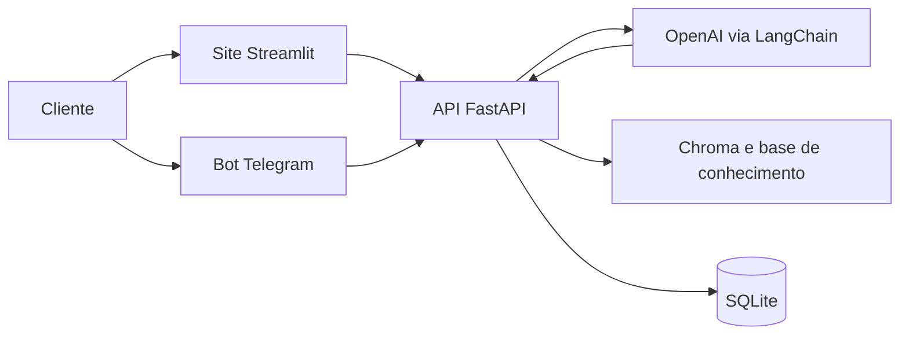

# Assistente de Atendimento e Agendamento — Barbearia Imperial

Projeto acadêmico de Ciência da Computação para apoiar o atendimento e o agendamento de uma barbearia. A aplicação reúne uma interface web, uma API, um assistente conversacional com OpenAI e um bot para Telegram.

O assistente interpreta as mensagens e consulta ferramentas do sistema para responder com informações atualizadas. A agenda e as reservas são verificadas e alteradas pelo servidor, que exige confirmação antes de concluir um agendamento, cancelamento ou remarcação.

## Objetivos do projeto

- Facilitar consultas sobre serviços, preços, horários e políticas da barbearia.
- Permitir agendamentos pela interface web e pelo bot do Telegram.
- Usar linguagem natural para consultar, cancelar e remarcar reservas.
- Aplicar validações no servidor para evitar conflitos e alterações sem confirmação.
- Avaliar a experiência de atendimento com testes e métricas documentados.

## Funcionalidades

- Chat com histórico de conversa e respostas em português brasileiro.
- Consulta de serviços, equipe, informações da barbearia, políticas e disponibilidade.
- Sugestões de horários vinculadas a vagas consultadas na agenda.
- Agendamento web com revisão dos dados e confirmação final.
- Consulta, cancelamento e remarcação de reservas com verificação de acesso.
- Área da equipe com agenda, bloqueios, serviços e solicitações de atendimento.
- Bot do Telegram com menus guiados e conversa livre com IA.
- Busca de políticas na base de conhecimento usando RAG.

## Arquitetura



| Parte | Responsabilidade |
| --- | --- |
| Streamlit | Site público de agendamento e área privada da equipe. |
| FastAPI | Endpoints, autenticação, validações e operações de agenda. |
| SQLite | Serviços, equipe, reservas, disponibilidade e atendimentos. |
| OpenAI e LangChain | Interpretação do histórico e uso de ferramentas do sistema. |
| Chroma | Busca de trechos relevantes na base de conhecimento. |
| Telegram Bot API | Recebimento e envio de mensagens do bot. |

## Tecnologias

- Python 3.12
- Streamlit e FastAPI
- SQLite
- LangChain e API da OpenAI
- Chroma para busca semântica
- Telegram Bot API
- Pytest

## Requisitos

- Python 3.12
- [`uv`](https://docs.astral.sh/uv/)
- Uma chave `OPENAI_API_KEY` para conversas livres com IA e busca RAG
- Um `TELEGRAM_BOT_TOKEN` para executar o bot do Telegram

As telas de agendamento do site e os menus guiados do Telegram podem ser usados sem a chave da OpenAI. Sem ela, a conversa livre informa que o atendimento virtual não está habilitado.

## Configuração local

Clone o repositório e instale as dependências:

```bash
git clone https://github.com/JoaoLeca/TCC-PARCIAL.git
cd TCC-PARCIAL
python -m pip install uv
uv sync --python 3.12
```

Crie o arquivo `.env` a partir do exemplo:

```powershell
Copy-Item .env.example .env
```

No macOS ou Linux, use `cp .env.example .env`. Preencha localmente as chaves necessárias:

```dotenv
OPENAI_API_KEY=sua_chave_openai
OPENAI_MODEL=gpt-5.4-mini
TELEGRAM_BOT_TOKEN=token_do_bot
DATABASE_PATH=data/barbearia.db
TIMEZONE=America/Sao_Paulo
```

Nunca envie o `.env` ou chaves privadas ao GitHub. A chave OpenAI e o token do Telegram são credenciais diferentes: a primeira habilita a IA; o segundo conecta o bot ao Telegram.

Para habilitar respostas sobre políticas, crie o índice local da base de conhecimento:

```bash
uv run python -c "from barber_bot.knowledge import ingest_knowledge; print(ingest_knowledge())"
```

## Executar

Inicie a API em um terminal:

```bash
uv run uvicorn barber_bot.api:app --app-dir src --reload
```

Inicie o site em outro terminal:

```bash
uv run streamlit run src/streamlit_app.py
```

O site será disponibilizado pelo endereço exibido pelo Streamlit. A documentação interativa da API estará em `http://127.0.0.1:8000/docs`.

Para executar também o bot do Telegram, use um terceiro terminal:

```bash
uv run python -m barber_bot.telegram_bot
```

No Telegram, `/agendar` e `/horarios` abrem os menus guiados. Conversas livres usam a OpenAI quando a chave estiver configurada.

## Testes e avaliação

Execute os testes automatizados:

```bash
uv run pytest
```

Os cenários de aceitação, procedimentos de avaliação e métricas estão na pasta [`eval/`](eval/roteiro_automacao.md). A execução de conversas reais com OpenAI e Telegram depende das respectivas credenciais; não compartilhe chaves, telefones ou códigos privados nos relatórios.

## Materiais acadêmicos

- [Documento do TCC em PDF](docs/tcc/TCC_CienciaDaComputacao_AtendimentoIARAG_LeonardoCoelho.pdf)
- [Apresentação do TCC em PDF](docs/apresentacao/apresentacao_tcc.pdf)
- [Roteiro de aceitação e avaliação](eval/roteiro_automacao.md)

## Limites do protótipo

Este repositório contém um protótipo acadêmico configurado para execução local. Antes de uma implantação pública, é necessário revisar autenticação, privacidade, limites de uso, configuração de segredos e operação do banco de dados.
